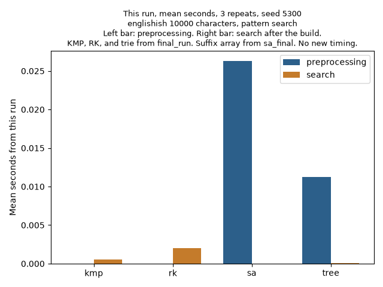
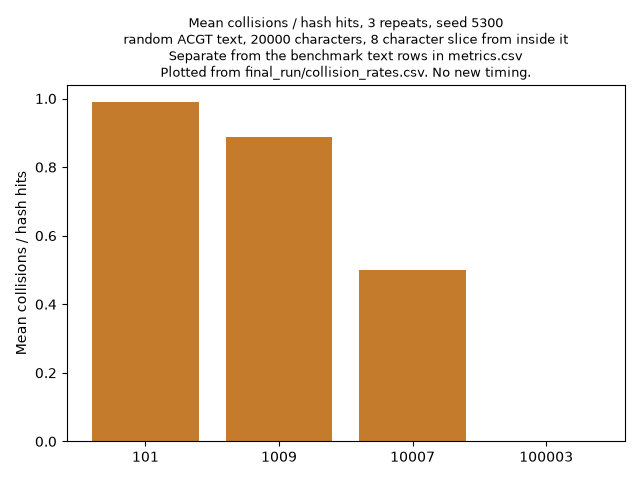
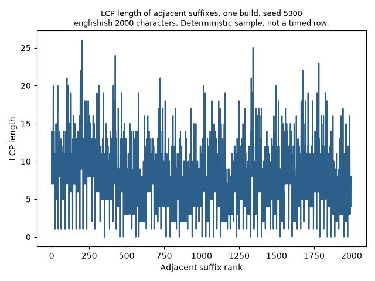
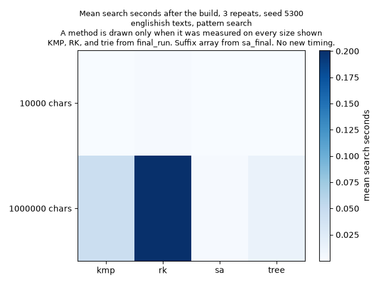

# StringSearchEngine

The assignment is CSC 5300 Week 11, Fast Pattern Matching. I search a text with Knuth Morris Pratt, Rabin Karp, a suffix array, and a compressed suffix tree.

## What it does

KMP builds a failure table and never moves backward in the text. Rabin Karp uses a rolling hash and can search many patterns in one pass. The suffix array is prefix doubling with a radix sort each round, plus binary search and a Kasai LCP array. The suffix tree is a compressed trie. It can test a substring, list prefix matches, find a longest repeated substring, and count distinct substrings.

## Install

From the project folder in PowerShell:

```
py -3.14 -m venv .venv
.venv\Scripts\Activate.ps1
py -3.14 -m pip install -r requirements.txt
```

## Run

From the project root:

```
python -m pytest tests
```

That is the check I use before I turn the project in. On my PC it is Python 3.14.7.

The benchmark command, if I ever need a new empty folder, is:

```
py -3.14 -m benchmarks.benchmark_search
```

The script stops when the output folder already has measurement files, so it will not nest another folder on top of a saved run. I am submitting the saved runs below. I did not rerun the benchmark for this writeup.

## Where the numbers come from

`benchmarks/results/runtime.csv` is my older combined run. One clock covered setup and search, and that file has no 1 MB trie row.

`benchmarks/results/pending_rerun` is an earlier split run.

`benchmarks/results/final_run` is the split run I use for KMP, Rabin Karp, the trie, and the collision table.

`benchmarks/results/sa_final/metrics.csv` is the later suffix array run. That build is the radix sort, `radix-doubling-v1`. The suffix array rows still sitting in `final_run` are the older comparison sort, so I do not use those cells in the current tables.

The four pictures that match the current tables are in `benchmarks/results/current_figures`. I plotted them from the saved CSVs. I did not time anything new to make them. The pictures directly in `benchmarks/results`, and the copies in `final_run` and `pending_rerun`, are earlier runs. The report links the `current_figures` set.









Chart titles name the generator, the seed, the pattern, and the quantity. The collision chart uses a separate random ACGT text. The LCP chart is one build on a 2,000 character englishish sample, seed 5300, and it is not a timed row.

## What the metric names mean

Preprocessing time is the setup before the lookup. Search latency is the lookup after that setup already exists. The mean is the average of the three repeats. The standard deviation is the population kind from `statistics.pstdev`, the same kind I used in `runtime.csv`.

The tracemalloc peak is the most bytes Python allocated during that one call. The preprocessing peak includes the build. The search peak is the lookup. I name the column with each number, because a Task Manager reading is a different measurement.

The Rabin Karp collision rate is the share of hash hits that failed the character check. The characters are still compared, so a collision is extra work and the match list stays correct. On the main texts the modulus is 1000000007, and that rate was 0. The collision chart uses smaller moduli, and the rate rises there.

## Layout

`core` holds the four matchers and `StringSearchEngine`. `applications` holds plagiarism, DNA, and autocomplete. `visualization` holds the two plot scripts. `utils` holds loaders, the rolling hash, and seeded generators. `analysis/chapter10_report.md` is the writeup. `analysis/demonstrations.md` is the KMP fallback trace and the Rabin Karp base table.
