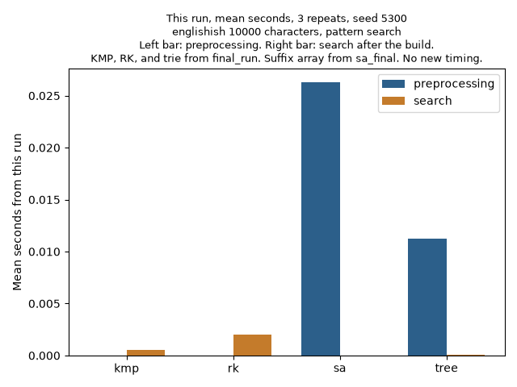
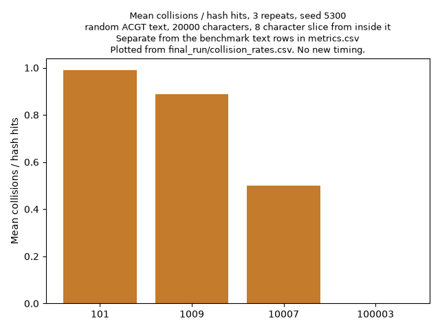
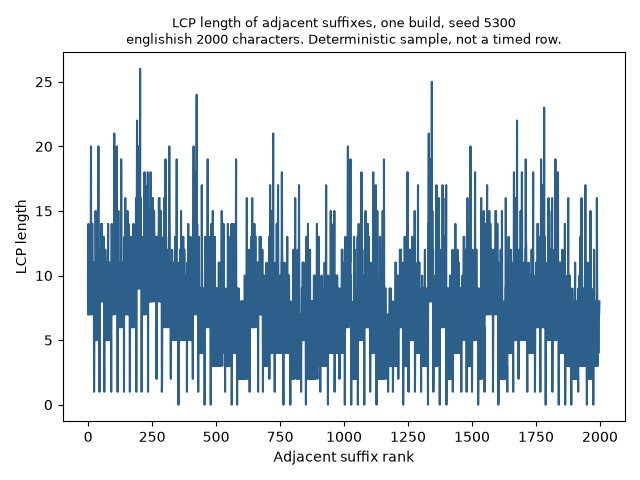
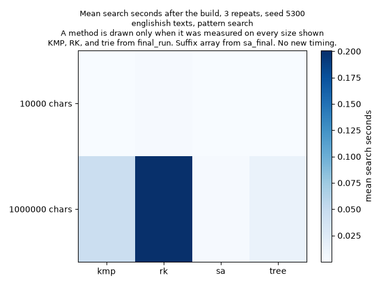

# Fast Pattern Matching

Omar Vasquez
Concordia University Texas
CSC 5300 Week 11

## Executive summary

The assignment is to compare four ways to find a pattern in a text, and to measure them on my own PC. I implemented Knuth Morris Pratt (KMP), Rabin Karp, a suffix array, and a compressed suffix tree. KMP is my default for one pattern. Rabin Karp fits many patterns in one pass. The suffix array and the suffix tree cost more to build and pay off when I query the same text many times.

The code is in this Python project, StringSearchEngine. My tests cover the failure table, repeated characters, a pattern longer than the text, hash collisions that still have to be verified, suffix array order, and tree queries. Seed 5300 produced the older combined times below. The current split times, peaks, and collision counts are the Python 3.14.7 runs in benchmarks/results/final_run and benchmarks/results/sa_final.

## String matching complexity

The naive search tries the pattern at every position. If the text length is n and the pattern length is m, the worst case is about n times m character comparisons.

KMP removes that waste. Section 10.3 of Amakobe describes the failure function. For each pattern position, the table stores the longest proper prefix that is also a suffix. The table is O(m). The search walks the text once. Total time is O(n + m). Space is O(m).

Rabin Karp, in section 10.4, turns the pattern into a number. The window hash updates in constant time. A matching hash is only a candidate, so I still compare the characters. Expected time is O(n + m). The worst case is O(n m) when collisions keep happening.

A suffix array lists every suffix start in sorted order. The prefix doubling build I use is O(n log n). Kasai's algorithm builds the LCP array in linear time, and a query is a binary search. A suffix tree stores the same suffixes in a compressed trie, so substring and prefix queries walk the edges.

## Implementation details

KMP lives in core/kmp.py. For ABABD the failure table is 0, 0, 1, 2, 0, as in section 10.3.2. For AABAAB it is 0, 1, 0, 1, 2, 3. An empty pattern, or a pattern longer than the text, returns an empty list. Overlaps stay, as when AAAAA is searched for AA. On a mismatch the pattern index falls back and the text index stays put. That trace is in analysis/demonstrations.md.

Rabin Karp lives in core/rabin_karp.py. The base is 256 and the modulus is 1000000007. Every hash hit is checked against the characters, and the object counts hits and collisions. A small base and modulus table is in that same demonstration. The verified positions did not change.

The suffix array in core/suffix_array.py uses prefix doubling, Kasai's LCP, and binary search. Each round is two stable counting passes, so the build is O(n log n). A comparison sort each round would be O(n log^2 n). The suffix tree in core/suffix_tree.py is Ukkonen's compressed trie. It tests a substring, lists starts and prefixes, finds a longest repeated substring, and counts distinct substrings.

StringSearchEngine(text).find(pattern, method, repeats=3) accepts kmp, rk, sa, or tree. It returns the positions, the match count, preprocessing_time, search_time, and a short recommendation. preprocessing_time is one setup. search_time is the mean of that many searches, and the setup is not inside those search clocks.

## Benchmark analysis

The first table is the earlier whole call on my PC: three repeats, seed 5300, pattern search. Std is statistics.pstdev. Those seven rows stay in benchmarks/results/runtime.csv. That run left out the 1 MB trie. One clock covered both phases.

| Dataset | Method | Mean seconds | Std seconds |
| --- | --- | --- | --- |
| 10 KB | kmp | 0.000666 | 0.000056 |
| 10 KB | rk | 0.002190 | 0.000266 |
| 10 KB | sa | 0.021563 | 0.000376 |
| 10 KB | tree | 0.033104 | 0.011877 |
| 1 MB | kmp | 0.051032 | 0.003464 |
| 1 MB | rk | 0.233437 | 0.007826 |
| 1 MB | sa | 6.761709 | 0.079170 |

KMP, Rabin Karp, the trie, and the collision rows are benchmarks/results/final_run from my PC, Python 3.14.7, seed 5300, pattern search, and three repeats. The suffix array rows are benchmarks/results/sa_final/metrics.csv, the radix build. The script times three builds and three lookups. engine.find is one setup, then the mean of three searches. Tracemalloc was off during the timers. I measured peak bytes afterward, after garbage collection. A Task Manager figure is a different measurement.

KMP setup is the failure table. Rabin Karp setup is the pattern hash and the window power. Suffix array setup builds the array. Trie setup is the Ukkonen build.

Current split times, in seconds. Suffix array lines are from sa_final. The other lines are from final_run:

```
dataset method setup_mean setup_std search_mean search_std
10KB kmp 0.000002233 0.000001558 0.000502267 0.000011675
10KB rk 0.000009633 0.000006133 0.002026267 0.000006994
10KB sa 0.026288800 0.000728760 0.000027267 0.000018128
10KB tree 0.011207800 0.000487881 0.000073033 0.000039484
1MB kmp 0.000002233 0.000002311 0.045424833 0.000312238
1MB rk 0.000005200 0.000004887 0.200714633 0.002030555
1MB sa 12.172076967 0.181625292 0.002275300 0.000857542
1MB tree 4.708075733 0.672019565 0.013319400 0.000154318
```

Peak Python allocation, in bytes. The suffix array peaks are from sa_final. The other peaks are from final_run.

```
dataset method setup_peak_mean setup_peak_std search_peak_mean search_peak_std
10KB kmp 168 0 5336 0
10KB rk 1270.667 19.956 5636 0
10KB sa 1274725 0 2790 0
10KB tree 2688629.333 9.978 6581.333 15.085
1MB kmp 168 0 508056 0
1MB rk 1068 13.064 508366.667 15.085
1MB sa 135123333 0 159206 0
1MB tree 271656049.333 9.978 560328 0
```

KMP setup is a few microseconds and its std is about as large as the mean, so that clock is noisy. The large peaks are the 1 MB trie at 271656049.333 bytes and the 1 MB radix suffix array at 135123333 bytes. The comparison-sort setup in final_run was 6.419160933 seconds at 1 MB. This radix build took 12.172076967 seconds. The O(n log n) bound is tighter, and on my PC the Python counting passes were slower.

The collision rate is collisions divided by hash hits, so it counts hash hits that failed the character check. Modulus 1000000007 gave 129 hits and 0 collisions on 10 KB, and 12506 hits and 0 collisions on 1 MB. The std is 0 because the three repeats used the same seeded text.

The modulus rows are benchmarks/results/final_run/collision_rates.csv. The text is 20000 random ACGT characters, pattern GGTGCTTA, seed 5300, three repeats.

```
modulus hash_hits collisions rate rate_std
101 196 194 0.989796 0
1009 18 16 0.888889 0
10007 4 2 0.500000 0
100003 2 0 0 0
```

A smaller modulus fails the character check more often. That rate std is also 0, from repeating the seeded text. The LCP chart is one deterministic 2000 character englishish sample, seed 5300, and it is not a timed row.

The pictures are benchmarks/results/current_figures. KMP, Rabin Karp, and the trie bars use final_run. The suffix array bars use sa_final. I did not time a new run. Files in benchmarks/results, final_run, and pending_rerun are earlier runs.









## Trade offs

KMP has a small setup and a fast scan for one pattern. A new pattern still walks the whole text.

Rabin Karp pays off when many patterns share a pass. One pattern is often no faster than KMP, and a small modulus adds checks. Every hash hit is still verified.

The suffix array fits a fixed text and many patterns. The O(n log n) build is the cost, and each later query is a binary search. The LCP array also feeds the plagiarism longest common substring. The tighter bound did not make the measured build faster in Python.

At 1 MB the Ukkonen setup mean is 4.708075733 seconds and the radix suffix array setup mean is 12.172076967 seconds. The trie search mean is 0.013319400 seconds. The build still dominates a one time search.

## Applications

plagiarism.py finds shared phrases with Rabin Karp, then uses the suffix array and LCP for a longest common substring. The score is the share of phrase windows from the first document that also appear in the second. highlight wraps those phrases in brackets.

dna_search.py loads data/sample.fasta, a short synthetic gene, and searches motifs with the suffix array and the suffix tree. It does not do approximate matching.

autocomplete.py returns the top completions for a prefix, by count and then by the word.

## Conclusion

KMP is the default I would keep for one pattern. Rabin Karp is what I would use for a set of patterns. A suffix array or a compressed trie is what I would build when one text will be queried many times. The split tables use final_run for KMP, Rabin Karp, and the trie, and sa_final for the radix suffix array.

## Source

Amakobe, M. (2025). Advanced algorithms: A journey through computational problem solving. Chapter 10.
